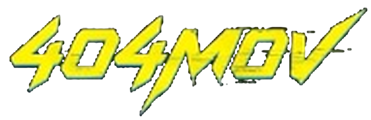

# 404MOV - Rapid Movie Decision Platform

<div align="center">



### Anti-Analysis Paralysis • Cyberpunk Console • Zero-Audio Architecture

[](https://github.com/404-Era)
[](https://react.dev/)
[](https://www.typescriptlang.org/)
[](https://fastapi.tiangolo.com/)
[](https://tailwindcss.com/)
[](README.md#zero-audio-architecture-100-silent)

</div>

---

## Table of Contents
1. [Overview & Philosophy](#-overview--philosophy)
2. [Zero-Audio Constraint (100% Silent)](#-zero-audio-constraint-100-silent)
3. [Key Features & User Experience](#-key-features--user-experience)
4. [Design System & Visual Identity](#-design-system--visual-identity)
5. [Roman Carax & Video Pipeline](#-roman-carax--video-pipeline)
6. [Complete Repository Architecture](#-complete-repository-architecture)
7. [REST API Documentation](#-rest-api-documentation)
8. [Installation & Getting Started](#-installation--getting-started)
9. [Automated Testing & Build Verification](#-automated-testing--build-verification)
10. [Telemetry Logging Standard](#-telemetry-logging-standard)
11. [License & Organization](#-license--organization)

---

## ⚡ Overview & Philosophy

**404MOV** (strictly written continuously without spaces) is not another bloated streaming catalog with endless rows of filler content. It is a **Rapid Movie Decision Engine** built specifically to eradicate **Analysis Paralysis**—the exhausting modern phenomenon where viewers spend 45+ minutes wandering through algorithmic catalogs only to end up frustrated.

### The Anti-Analysis Paralysis Rule
At any given moment, 404MOV curates and locks in **strictly 3 to 5 uncompromising, high-caliber recommendations** matching the user's intent. If filters narrow choices below 3, top-rated database items pad the list so the user is never stranded with an empty or solitary decision dead-end.

---

## 🔇 Zero-Audio Constraint (100% Silent)

In accordance with strict system specifications, 404MOV is guaranteed **100% silent**:
- ❌ **NO** `<audio>` or `<video>` HTML audio elements.
- ❌ **NO** Web Audio API (`AudioContext`, `createGain`, oscillators).
- ❌ **NO** audio files (`.mp3`, `.wav`, `.ogg`, `.flac`).
- ❌ **NO** volume, mute, or speaker icons anywhere in the user interface.
- 🎥 Animated hero visuals use lightweight, silent **lossless/high-quality WebP** streams (`character_isolated.webp`) with zero audio tracks.

---

## 🌟 Key Features & User Experience

### 1. Unified Cyberpunk Console & Search
- **Mode 1: Title Search:** Exact title, director, keyword, and actor lookup.
- **Mode 2: Vibe & Mood:** Semantic mood query ("mind-bending reality collapse", "neon retro synth thriller").
- **Mode 3: 404 Brain Not Found:** Interactive triage modal featuring **Instant Cinema Roulette** (1 guaranteed masterclass pick) and 3-step rapid vibe triage.

### 2. 3-Click Rapid Selector Pills
- **Duration Filters:** `Under 90 mins` • `2h Standard` • `Miniseries`
- **Vibe Filters:** `Adrenaline Rush` • `Mind-Bending` • `Cozy & Light` • `Dark & Deep`
- **Primary Trigger:** `Solve My 404` CTA styled with high-voltage radar green bloom.

### 3. Spotlight Grid (Prime Video Hover Interaction)
- **Base State:** Pristine 2:3 vertical posters showing title, release year, and score badge with zero layout shifts.
- **Hover State:** Smooth 220ms cubic-bezier transition scaling the card up by ~40% into a wide 16:9 cinematic preview. Displays runtime, maturity rating, genres, and a 1-sentence decision hook (*"Why it fits your vibe"*).
- **Zero Vertical Clipping:** Scroll rows incorporate generous vertical padding (`py-12 md:py-14`) so expanded cards float freely above neighboring elements.
- **Quick Bookmark:** Instant watchlist storage via `localStorage` (Zero login friction).

### 4. Dedicated Movie Hub Page (`/movie/:id`)
Opens in a separate browser tab (`target="_blank"`) to preserve search parameters:
- **Cinematic Hero:** Full-width dimmed backdrop, high-res poster, metadata, and decision hook.
- **Aggregated Ratings Matrix:** Verified scores from **IMDb**, **Rotten Tomatoes**, and **Metacritic** with custom visual progress meters.
- **Where to Watch Hub (Structured 3 Tabs):**
  1. *Direct & Uncensored Streams:* Direct downloads and streaming mirrors categorized by resolution (**4K UHD Remux**, **1080p Web-DL**, **720p Mobile**) with file sizes, audio specs (Dolby Atmos, DTS-HD), and subtitles.
  2. *Family / Censored Versions:* Filtered streaming links with explicit editorial notes detailing runtime differences and adjustments.
  3. *Official Streaming Services:* Direct links to Netflix, Prime Video, Apple TV+, Max, and Hulu with pricing tiers.
- **Video Essays & Critical Reviews:** Curated deep-dive video breakdowns (Thomas Flight, StudioBinder, Every Frame a Painting) and verified quotes from film critics.
- **Similar Vibes Radar:** Exactly 3 immediate alternative recommendations sharing similar themes.

---

## 🎨 Design System & Visual Identity

| Token Name | Value | Purpose |
|---|---|---|
| **Obsidian Matte** | `#0A0B0E` | Main matte background with subtle micro-grain noise overlay |
| **Cyber Yellow** | `#FCEE09` | Exclusive angular brand logo (`404MOV`) and Mode 3 highlights |
| **Radar Cyber-Green** | `#00FFA3` / `#10E7B2` | Camera monitor screen, execute button, and `Solve My 404` CTA |
| **Frosted Surface** | `rgba(18, 22, 28, 0.72)` | Glassmorphism cards and search console with `backdrop-filter: blur(16px)` |
| **Refined Hover Border** | `rgba(255, 255, 255, 0.18)` | Minimal 1px border and deep drop shadows (No neon slop) |
| **Typography Contrast** | `#EDEDED` / `#8F9CA8` | Matte white titles, cool gray metadata and technical tags |

### Brand Logo Glitch Mechanic
The `404MOV` logo is fixed at `top: 1.25rem; left: 1.75rem`. It remains clean, sharp, and stable **95% of the time**. Every 4.5 seconds, a 200ms micro-pixel horizontal displacement and slice glitch triggers via pure CSS keyframes (`microGlitch`), inspired by sharp cyberpunk typography.

---

## 🎬 Roman Carax & Video Pipeline

Roman Carax is the cyberpunk camera operator mascot rendered above the search bar:
- **Interactive Parallax:** Subtly tilts head and handheld cyber-camera following cursor movement within a safe constrained $\pm 5^\circ$ cone.
- **Typing Focus:** Scales slightly on input focus to simulate active monitoring.
- **Transparent Alpha Matte:** Extracted directly from reference footage (`media/1.mp4`) via OpenCV.

### Computer Vision Pipeline (`scripts/render_high_res_character.py`)
1. **Bilinear Studio Lighting Estimation:** Samples border strips to interpolate non-uniform studio illumination across X coordinates.
2. **Exterior Connected-Component Analysis:** Zeroes out dark studio backdrops contiguous with the border.
3. **Specularity Preservation:** Morphological closing protects eye highlights, camera reticles, and lens reflections.
4. **Luminance Falloff Gate:** Subpixel falloff filter completely eliminates slate-colored artifacts above the hair while preserving fine hair strands.
5. **High-Frequency Unsharp Masking:** Enhances edge definition on anime linework and dials (+80.2% sharpness gain).
6. **Master WebP Compiler:** 120-frame HD animated WebP at exact 1.0x normal speed (83ms/frame, 10.0s loop).

---

## 📂 Complete Repository Architecture

```text
404mov/
├── .gitignore                      # Prevents committing node_modules, dist, cache, or logs
├── README.md                       # Comprehensive platform documentation (this file)
├── requirements.txt                # Python backend & computer vision dependencies
│
├── backend/                        # [SERVER - Python FastAPI]
│   ├── main.py                     # REST API endpoints, search heuristics, telemetry
│   ├── test_api.py                 # Automated unit and integration test suite
│   ├── requirements.txt            # Dedicated backend dependencies
│   └── data/
│       ├── __init__.py
│       └── movies.py               # Verified catalog with watch tabs & ratings
│
├── frontend/                       # [CLIENT - React 19 + TypeScript + Vite]
│   ├── index.html                  # HTML5 entry point & custom typography
│   ├── package.json                # Frontend packages & build scripts
│   ├── vite.config.ts              # Vite bundler configuration
│   ├── tsconfig.json               # TypeScript strict configuration
│   ├── public/                     # Static production assets
│   │   ├── favicon.svg             # Cyberpunk browser tab favicon
│   │   ├── icons.svg               # SVG icon sprites
│   │   └── assets/                 # Character WebP, logos, posters, and avatars
│   └── src/
│       ├── main.tsx                # Client application root mount
│       ├── App.tsx                 # Client router (Home & Movie Hub)
│       ├── types.ts                # Strict TypeScript interfaces
│       ├── pages/
│       │   ├── HomePage.tsx        # Decision console & Spotlight Grid
│       │   └── MovieHubPage.tsx    # 3-Tab streaming hub & critic matrix
│       ├── components/             # Reusable cyberpunk UI components
│       │   ├── SearchBar.tsx       # Cyber console search input
│       │   ├── HeroVideoBackdrop.tsx # Roman Carax parallax character
│       │   ├── SpotlightGrid.tsx   # Curated rows with hover breathing room
│       │   ├── SpotlightCard.tsx   # Prime Video hover preview card
│       │   ├── BrainNotFoundModal.tsx # Mode 3 Roulette & vibe triage
│       │   ├── RapidSelectorPills.tsx # 3-Click duration & vibe selectors
│       │   ├── BrandLogo.tsx       # Glitching 404MOV vector logo
│       │   ├── WatchlistDrawer.tsx # Drawer showing saved bookmarks
│       │   └── TelemetryDrawer.tsx # Real-time interaction event log viewer
│       └── services/               # State, telemetry, & API services
│           ├── api.ts              # Decoupled REST client with offline fallback
│           ├── fallbackData.ts     # Offline resilient movie catalog
│           ├── telemetry.ts        # Structured interaction logger
│           └── watchlist.ts        # LocalStorage reactive bookmark storage
│
├── media/                          # Master reference footage (1.mp4)
│   └── 1.mp4                       # Original 720p 24fps source video
│
└── scripts/                        # Media & asset extraction pipelines
    ├── render_high_res_character.py # Master OpenCV character isolation script
    ├── extract_character.py        # Reference crop utility
    ├── extract_logo.py             # Alpha logo extractor
    ├── extract_new_logo.py         # Portable SVG logo wrapper
    ├── generate_logo_svg.py        # Vector SVG converter
    └── upscale_logo.py             # 4x Lanczos logo sharpener
```

---

## 📡 REST API Documentation

Base URL: `http://127.0.0.1:8000`

| Method | Endpoint | Query Parameters | Description |
|---|---|---|---|
| `GET` | `/api/health` | None | Returns engine status, zero-audio compliance, and database movie count. |
| `GET` | `/api/movies` | `q`, `mode`, `duration`, `vibe`, `limit` | Returns strictly 3–5 curated movies matching query, duration, and mood. |
| `GET` | `/api/movies/{id}` | None | Returns full movie hub metadata, 3 watch tabs, ratings matrix, and 3 similar vibes. |
| `GET` | `/api/roulette` | `vibe` (optional) | Mode 3 instant cure: Picks 1 high-impact masterclass recommendation. |
| `POST` | `/api/telemetry` | JSON body (`TelemetryEvent`) | Records user interactions adhering to standard format. |
| `GET` | `/api/telemetry` | `limit` (default: 50) | Returns in-memory telemetry interaction logs. |

### Sample Request & Response (`/api/movies?vibe=Adrenaline+Rush&limit=4`):
```json
{
  "count": 4,
  "query": null,
  "mode": "mode1",
  "duration": null,
  "vibe": "Adrenaline Rush",
  "results": [
    {
      "id": "mad-max-fury-road",
      "title": "Mad Max: Fury Road",
      "year": 2015,
      "rating": "R",
      "scoreBadge": 8.1,
      "duration": "2h 00m",
      "genres": ["Action", "Adventure", "Sci-Fi"],
      "decisionHook": "A two-hour visual hurricane of practical stunts and relentless kinetic momentum."
    }
  ]
}
```

---

## 🚀 Installation & Getting Started

### Prerequisites
- **Node.js** (v18.0.0 or higher) & **npm**
- **Python** (v3.10 or higher) & **pip**
- **Git**

### 1. Clone the Repository
```bash
git clone https://github.com/404-Era/404-MOV.git
cd 404-MOV
```

### 2. Backend Setup (FastAPI)
```bash
# Install Python dependencies
pip install -r requirements.txt

# Start the FastAPI backend server
python -m uvicorn backend.main:app --host 127.0.0.1 --port 8000
```
*Backend runs live at [http://127.0.0.1:8000](http://127.0.0.1:8000)*

### 3. Frontend Setup (React + Vite)
In a new terminal window:
```bash
cd frontend

# Install Node dependencies
npm install

# Start Vite development server
npm run dev -- --host 127.0.0.1 --port 5173
```
*Frontend runs live at [http://127.0.0.1:5173](http://127.0.0.1:5173)*

---

## 🧪 Automated Testing & Build Verification

### Run Backend API Test Suite
```bash
python backend/test_api.py
```
**Verification Coverage:**
- `[PASS]` Zero-audio health check
- `[PASS]` Default 3–5 anti-analysis paralysis count
- `[PASS]` Duration filter (`under-90`)
- `[PASS]` Vibe filter (`Adrenaline Rush`)
- `[PASS]` Dedicated Movie Hub detail & 3 watch tabs
- `[PASS]` Mode 3 Roulette randomizer
- `[PASS]` Telemetry logging standard

### Run Frontend Production Build
```bash
cd frontend
npm run build
```
Compiles and validates TypeScript types and Tailwind CSS output into `dist/` with zero warnings.

---

## 📊 Telemetry Logging Standard

Every user interaction produces a structured log:
```text
[TIMESTAMP] [EVENT_TYPE] | Component -> Details
```

### Standard Interaction Events
- `SEARCH_QUERY`: Logged on query execution and reticle calibration.
- `FILTER_SELECT`: Logged on clicking duration pills, vibe pills, or `Solve My 404`.
- `HOVER_CARD_EXPAND`: Logged when a spotlight card scales into 16:9 preview mode.
- `OPEN_MOVIE_TAB`: Logged when navigating to `/movie/:id` in a new browser tab.
- `DOWNLOAD_SOURCE_CLICK`: Logged on selecting direct streams, family versions, or official links.
- `WATCHLIST_TOGGLE`: Logged when saving or removing a title from bookmarks.

*Click the telemetry terminal icon in the bottom-right corner of the website to view live telemetry events.*

---

## 🏢 License & Organization

Maintained by **[404-Era](https://github.com/404-Era)**.  
Built for film lovers who value their time.  
**404MOV: Stop Searching. Start Watching.**
